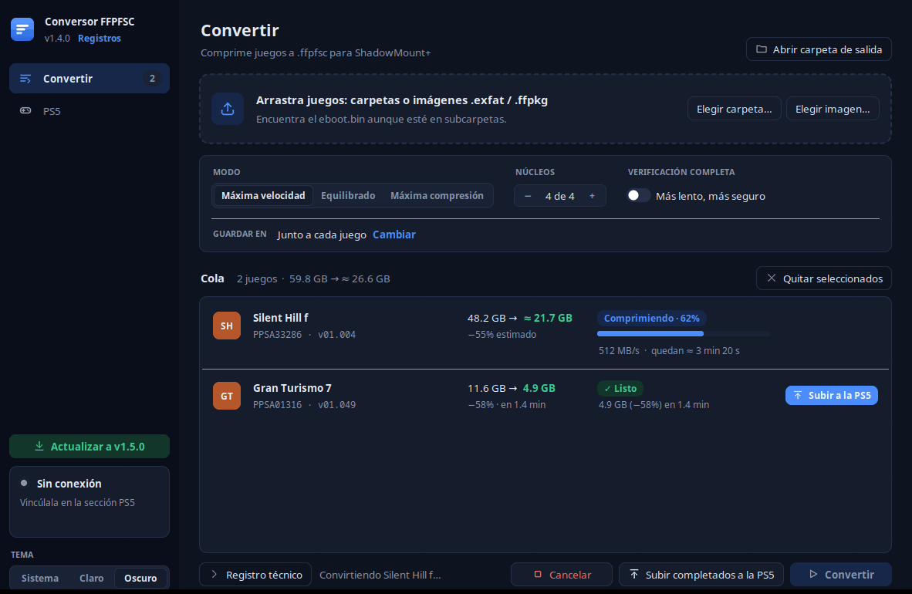
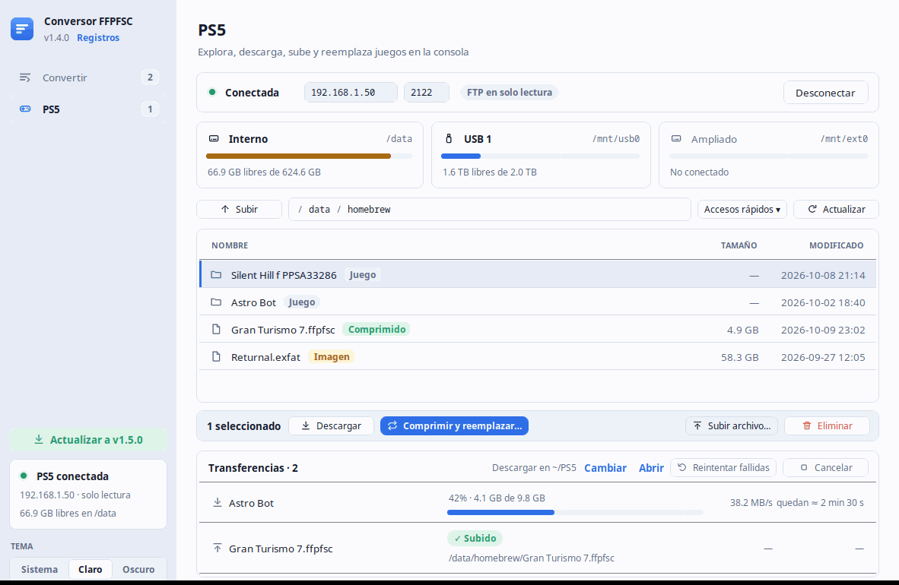
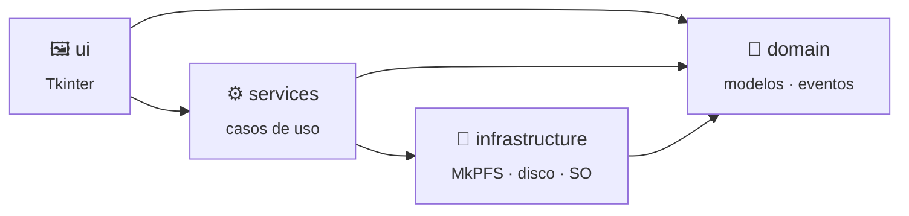

<div align="center">


# Conversor FFPFSC

### Comprime tus juegos de PS5 a `.ffpfsc` arrastrando y soltando

**Carpeta de juego · `.exfat` · `.ffpkg` &nbsp;→&nbsp; `.ffpfsc`**

[](CHANGELOG.md)
[](https://www.python.org/)
[](#-instalación)
[](#-instalación)
[](https://github.com/PSBrew/MkPFS)
[](tests/)
[](https://docs.astral.sh/ruff/)

<br/>


<br/><br/>


<br/>

[Características](#-características) •
[Instalación](#-instalación) •
[Uso](#-uso) •
[Arquitectura](#-arquitectura) •
[Desarrollo](#-desarrollo) •
[Documentación](#-documentación)

</div>

---

## ✨ Características

<table>
<tr>
<td width="50%" valign="top">

### 🖱️ Arrastrar y soltar
Suelta una o varias carpetas o imágenes sobre la ventana. El programa
encuentra solo el `eboot.bin` o la imagen aunque esté varios niveles más
adentro.

### 🏷️ Nombre oficial del juego
Lee `sce_sys/param.json` (también dentro de `.exfat`) y muestra título,
Title ID y versión, priorizando el idioma del juego y luego español.

### 📏 Estimación antes de convertir
Calcula en segundos el **peso final** para cada modo comprimiendo una muestra
aleatoria de bloques, y avisa si no hay espacio suficiente en destino.

### 🎨 Tema claro y oscuro
Sigue al tema del sistema (o el que elijas) y se ve nítida en pantallas HiDPI.

</td>
<td width="50%" valign="top">

### ⚡ Máxima velocidad
Usa todos los núcleos de la CPU y el backend **zlib-ng**, el único seguro para
el descompresor de la PS5.

### 📋 Cola de conversión
Convierte varios juegos seguidos con progreso, velocidad en vivo y registro
completo de MkPFS.

### 🛡️ Seguro por diseño
Verificación de estructura siempre (o completa, opcional), confirmación antes
de sobrescribir y borrado automático de salidas incompletas al cancelar o fallar.

### 🔔 Aviso de versiones nuevas
Si hay una versión publicada más nueva, un botón verde te lleva a descargarla.

</td>
</tr>
</table>

### 🎮 Explorador de la PS5

Sección **PS5** para una consola con el payload de [ps5upload](https://github.com/phantomptr/ps5upload)
**6.x** (incluido en [`payload/`](payload/)): espacio libre de cada unidad, **descargar**,
**subir**, **eliminar** y **comprimir y reemplazar** un juego en un solo paso (descarga,
compresión, subida verificada y reemplazo del original). Desde **Convertir**, cada juego
comprimido se sube con un clic. La app inicia sola el FTP del helper (en solo lectura y con
credenciales aleatorias) tras emparejarse una vez. Guía: **[docs/PS5.md](docs/PS5.md)**.

### Modos de compresión

| Modo | Nivel zlib | Cuándo usarlo |
|:-----|:----------:|:--------------|
| 🚀 **Máxima velocidad** *(por defecto)* | 3 | Casi siempre: compresión muy cercana al máximo en mucho menos tiempo. |
| ⚖️ **Equilibrado** | 6 | Un poco más pequeño a cambio de algo más de tiempo. |
| 🗜️ **Máxima compresión** | 9 | Cuando cada GB cuenta y no importa esperar. |

---

## 📦 Instalación

Funciona en **Linux** y **Windows 10/11** (64 bits) con **Python 3.10+**.

<details open>
<summary><b>🐧 Linux</b> (probado en Ubuntu)</summary>

```bash
git clone git@github.com:vzepec/conversor-ffpfsc.git
cd conversor-ffpfsc
./instalar.sh
```

El instalador añade `python3-tk` y `python3-venv` si faltan, crea `.venv/`,
instala [MkPFS](https://github.com/PSBrew/MkPFS), `zlib-ng` y `tkinterdnd2`, y crea
el acceso directo en el Escritorio y en el menú de aplicaciones.

</details>

<details open>
<summary><b>🪟 Windows</b> 10/11</summary>

1. Instala [Python 3.10+](https://www.python.org/downloads/windows/) marcando
   **Add python.exe to PATH** (tkinter viene incluido).
2. Descarga el repositorio (`git clone` o **Code → Download ZIP**) y descomprímelo.
3. Haz doble clic en **`instalar.bat`**.

Se crea el acceso directo **Conversor FFPFSC** en el Escritorio y en el menú
Inicio. Puedes arrastrar un juego sobre el acceso directo para abrirlo ya en la cola.

</details>

📖 Requisitos detallados y solución de problemas: **[docs/INSTALLATION.md](docs/INSTALLATION.md)**

---

## 🚀 Uso

```text
 ┌─────────────────────┐     ┌────────────────────┐     ┌────────────────────┐
 │ 1. Arrastra el juego│ ──▶ │ 2. Revisa nombre y │ ──▶ │ 3. ▶ Convertir     │
 │    a la ventana     │     │    peso estimado   │     │    → Juego.ffpfsc  │
 └─────────────────────┘     └────────────────────┘     └────────────────────┘
```

Abre la app desde el acceso directo, o desde la terminal:

```text
./abrir.sh "$HOME/Juegos/Mi Juego" otro.exfat     # Linux
abrir.bat "D:\Juegos\Mi Juego" otro.exfat         # Windows
```

📖 Guía completa con opciones y preguntas frecuentes: **[docs/USER_GUIDE.md](docs/USER_GUIDE.md)**

---

## 🏗️ Arquitectura

Arquitectura en capas donde **las dependencias solo apuntan hacia abajo** y la
interfaz nunca habla directamente con MkPFS:



```text
src/ffpfsc_converter/
├── config.py          # todas las constantes
├── errors.py          # errores con mensajes para el usuario
├── domain/            # modelos y eventos — Python puro
├── infrastructure/    # adaptador MkPFS, sistema de archivos, escritorio
├── services/          # descubrir · metadatos · estimar · analizar · convertir
└── ui/                # vistas, presentadores (textos), tema y widgets propios
```

Los servicios corren en hilos de fondo y publican **eventos tipados** en una
cola; la ventana los consume en el hilo de Tkinter. Detalles, diagramas de
secuencia y decisiones técnicas en **[docs/ARCHITECTURE.md](docs/ARCHITECTURE.md)**.

---

## 🧑‍💻 Desarrollo

```bash
./instalar.sh --dev            # + pytest y ruff (Windows: instalar.ps1 -Dev)
source .venv/bin/activate      # Windows: .venv\Scripts\activate

pytest                         # tests
ruff check src tests tools     # lint
python tools/check_standards.py  # ≤ 250 líneas por archivo y docstrings completas
python -m ffpfsc_converter     # ejecutar desde el código
```

El repositorio define **rules** obligatorias en [`.claude/rules/`](.claude/rules/), verificadas
automáticamente por `pytest`:

- 📏 **Ningún archivo supera 250 líneas**; si crece, se modulariza.
- 📝 **Toda función documentada** en español neutro: descripción breve, `Args`, `Returns` y `Raises`.
- 🧹 **Código limpio** y ✅ **buenas prácticas** con una definición de terminado clara.

Además incluye **skills de Claude Code** en [`.claude/skills/`](.claude/skills/) con guías detalladas:

| Skill | Define |
|:------|:-------|
| [`ffpfsc-architecture`](.claude/skills/ffpfsc-architecture/SKILL.md) | Capas, reglas de importación y dónde va cada cambio |
| [`ffpfsc-clean-code`](.claude/skills/ffpfsc-clean-code/SKILL.md) | Nombres, funciones, tipos, docstrings y manejo de errores |
| [`ffpfsc-best-practices`](.claude/skills/ffpfsc-best-practices/SKILL.md) | Hilos y Tkinter, MkPFS, tests, Git y checklist antes de commitear |

Más en **[docs/DEVELOPMENT.md](docs/DEVELOPMENT.md)**.

---

## 📚 Documentación

| Documento | Contenido |
|:----------|:----------|
| [📦 Instalación](docs/INSTALLATION.md) | Linux y Windows: requisitos, pasos y solución de problemas |
| [📖 Guía de uso](docs/USER_GUIDE.md) | Formatos aceptados, opciones, preguntas frecuentes |
| [🎮 Sección PS5](docs/PS5.md) | Emparejamiento, explorar, descargar, subir y reemplazar |
| [🏗️ Arquitectura](docs/ARCHITECTURE.md) | Capas, flujo, modelo de hilos, decisiones, cómo extender |
| [🧑‍💻 Desarrollo](docs/DEVELOPMENT.md) | Entorno, tests, flujo de Git, publicar versiones |
| [📝 Changelog](CHANGELOG.md) | Historial de cambios |

---

## 🙏 Créditos

- **[MkPFS](https://github.com/PSBrew/MkPFS)** de PSBrew: el motor que genera las imágenes PFS/PFSC.
- **[zlib-ng](https://github.com/zlib-ng/zlib-ng)**: compresión rápida y compatible con la PS5.
- **[ps5upload](https://github.com/phantomptr/ps5upload)** de PhantomPtr: el helper de la PS5, su
  servidor FTP y la especificación del protocolo AVA1 que implementa la vista PS5.
- **[tkinterdnd2](https://github.com/Eliav2/tkinterdnd2)**: arrastrar y soltar en Tkinter.

> [!IMPORTANT]
> Esta herramienta está pensada para respaldar **juegos de tu propiedad**.
> No incluye ni distribuye contenido protegido por derechos de autor.

<div align="center">
<sub>Hecho con ☕ por <a href="https://github.com/vzepec">vzepec</a></sub>
</div>
