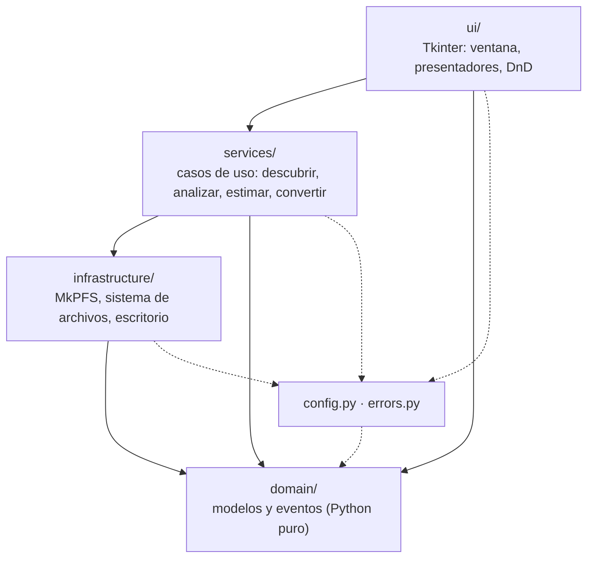
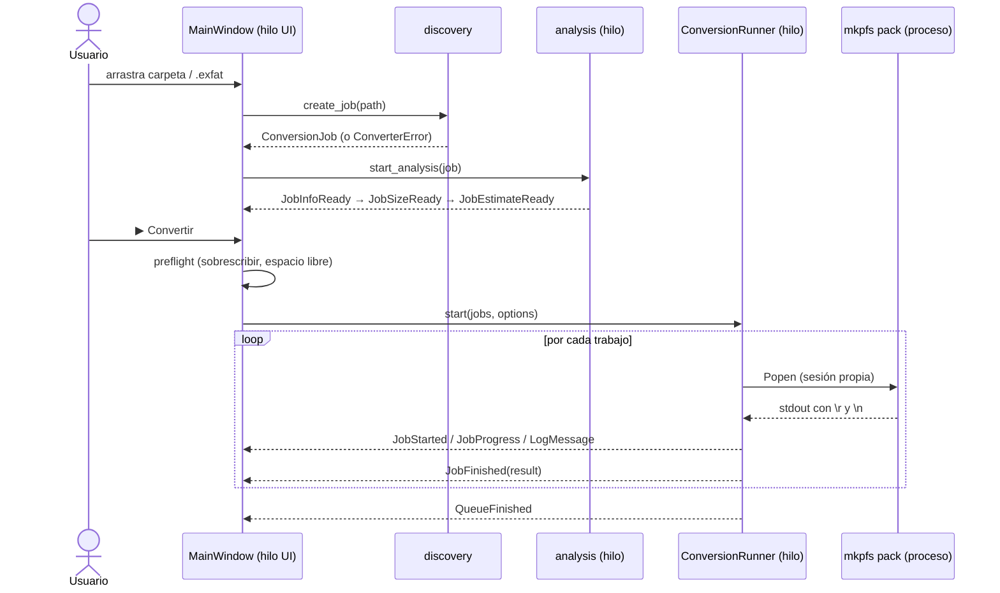

# Arquitectura

El conversor sigue una **arquitectura en capas** con una única regla:
**las dependencias solo apuntan hacia abajo**.



| Capa | Paquete | Puede importar | Nunca importa |
|------|---------|----------------|---------------|
| Dominio | `domain/` | solo la biblioteca estándar | nada del proyecto, `tkinter`, `mkpfs`, `subprocess` |
| Infraestructura | `infrastructure/` | `domain`, `config`, `mkpfs`, `subprocess`, `os` | `services`, `ui`, `tkinter` |
| Servicios | `services/` | `domain`, `infrastructure`, `config`, `errors` | `ui`, `tkinter` |
| Presentación | `ui/` | todo lo anterior | `subprocess`, `mkpfs` (usa servicios) |

## Estructura

```text
src/ffpfsc_converter/
├── __init__.py            # __version__
├── __main__.py            # python -m ffpfsc_converter [rutas...]
├── config.py              # TODAS las constantes (presets, backend, márgenes…)
├── errors.py              # ConverterError y subclases con mensajes para el usuario
├── domain/
│   ├── models.py          # ConversionJob, GameInfo, ConversionOptions, JobState…
│   └── events.py          # Eventos servicio → UI (JobStarted, JobProgress…)
├── infrastructure/
│   ├── mkpfs_adapter.py   # Comando `mkpfs pack`, proceso, parseo de progreso, metadatos
│   ├── filesystem.py      # Listado de archivos, espacio libre, borrado seguro
│   └── system.py          # Abrir carpeta con xdg-open
├── services/
│   ├── discovery.py       # Encontrar eboot.bin / imagen y crear el ConversionJob
│   ├── metadata.py        # Nombre, Title ID y versión desde param.json
│   ├── estimator.py       # Estimación del tamaño final por muestreo
│   ├── analysis.py        # Hilo que completa info + tamaño + estimación
│   ├── preflight.py       # Comprobación de espacio libre
│   └── conversion.py      # ConversionRunner: cola secuencial con cancelación
└── ui/
    ├── app.py             # MainWindow: construye widgets y despacha eventos
    ├── presenters.py      # Funciones puras que generan los textos mostrados
    ├── theme.py           # Colores, fuentes y medidas
    └── dnd.py             # Arrastrar y soltar opcional (tkinterdnd2)
```

## Flujo de una conversión



### Modelo de hilos

- **Tkinter no es seguro entre hilos.** Ningún servicio toca widgets.
- Los servicios reciben un `EventSink` (en la app: `queue.Queue.put`) y
  publican eventos inmutables (`@dataclass(frozen=True)`).
- `MainWindow._poll_events` vacía la cola cada 100 ms en el hilo de la UI y
  despacha cada evento a su manejador mediante un diccionario `tipo → método`.
- La cancelación usa un `threading.Event`; el proceso de MkPFS se lanza con
  `start_new_session=True` para matar también sus procesos hijo con `killpg`.

## Decisiones técnicas

| Decisión | Motivo |
|----------|--------|
| Backend `zlib-ng` fijo | `isal` genera bloques que la PS5 lee mal ([MkPFS #132](https://github.com/PSBrew/MkPFS/issues/132)). |
| MkPFS como **subproceso** y no como librería | Aísla fallos, permite cancelar con señales y aprovecha su paralelismo multiproceso. |
| `--temp-folder` = carpeta de destino | Evita llenar `/tmp` con imágenes de decenas de GB. |
| `--require-game-files` solo para carpetas | Detecta pronto carpetas que no son juegos. |
| Estimación por muestreo (1536 bloques de 64 KiB, semilla fija) | ~96 MB leídos por juego dan un error típico de pocos puntos porcentuales en segundos, y siempre la misma cifra para el mismo juego. |
| Bloques que no reducen se cuentan en crudo | Replica el comportamiento de PFSC de MkPFS. |
| `read_game_info` nunca lanza | El nombre del juego es informativo; no debe impedir convertir. |
| Salida parcial borrada ante error o cancelación | Nunca queda un `.ffpfsc` corrupto que parezca válido. |

## Cómo extender

| Quiero… | Dónde |
|---------|-------|
| Añadir un modo de compresión | Agrega un `CompressionPreset` a `PRESETS` en `config.py`. La estimación lo calcula sola. |
| Pasar una opción nueva a MkPFS | Campo en `ConversionOptions` → `build_pack_command` → control en `ui/app.py`. Test en `test_mkpfs_adapter.py`. |
| Soportar otro formato de origen | `IMAGE_EXTENSIONS` en `config.py`; si necesita lógica, `services/discovery.py`. |
| Mostrar un dato nuevo en la tabla | Evento en `domain/events.py` → publicarlo en el servicio → manejador en `MainWindow._handlers` → texto en `presenters.py`. |
| Crear una CLI sin interfaz | Nuevo paquete `cli/` que use `services/` con un `EventSink` que imprima. No requiere tocar servicios. |
| Soportar Windows/macOS | `infrastructure/system.py` (abrir carpeta) y `PackProcess.terminate` (señales). |

Las reglas detalladas están en las skills de [`.claude/skills/`](../.claude/skills/).
