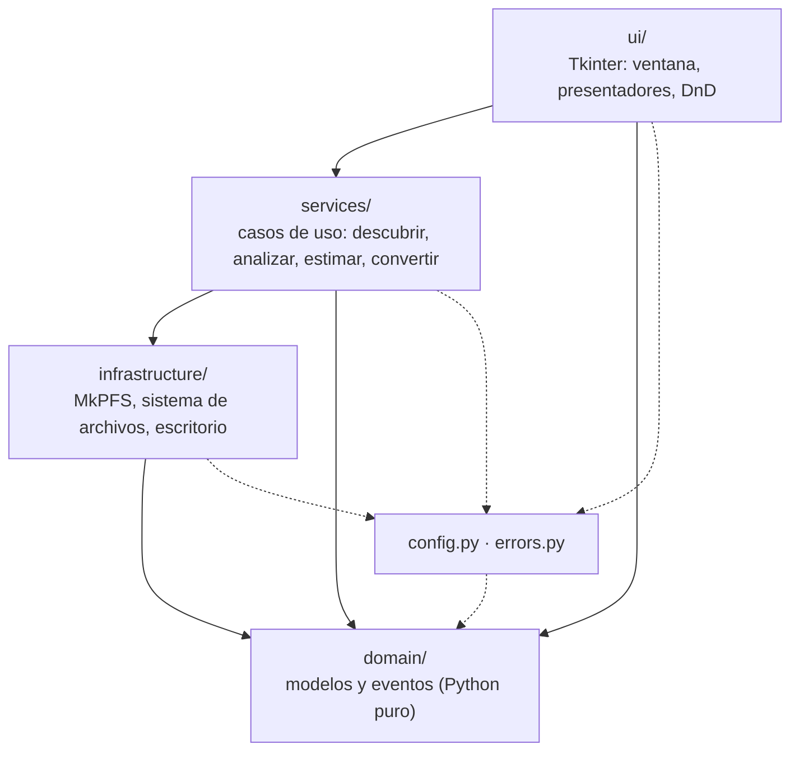
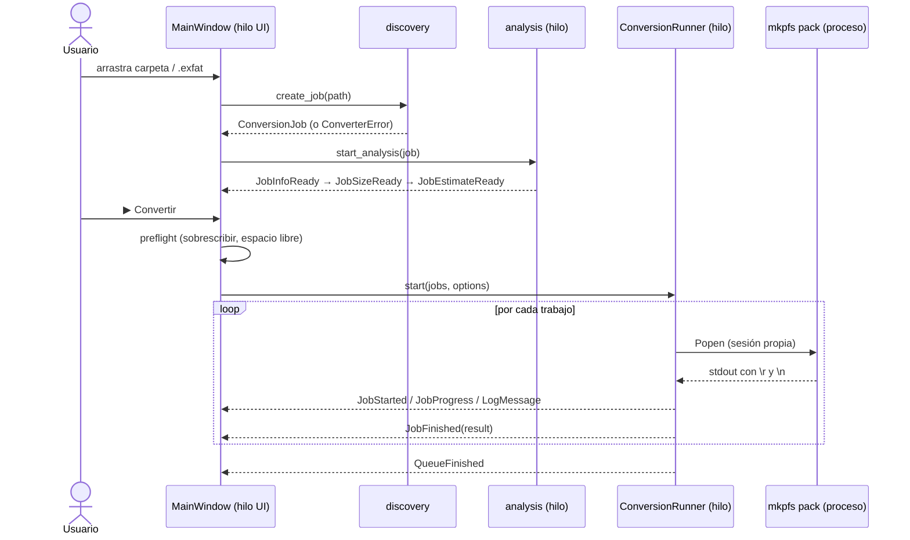

# Arquitectura

El conversor sigue una **arquitectura en capas** con una única regla:
**las dependencias solo apuntan hacia abajo**.



| Capa | Paquete | Puede importar | Nunca importa |
|------|---------|----------------|---------------|
| Dominio | `domain/` | solo la biblioteca estándar | nada del proyecto, `tkinter`, `mkpfs`, `subprocess` |
| Infraestructura | `infrastructure/` | `domain`, `config`, `mkpfs`, `subprocess`, `os` | `services`, `ui`, `tkinter` |
| Servicios | `services/` | `domain`, `infrastructure`, `config`, `errors` | `ui`, `tkinter` |
| Presentación | `ui/` | todo lo anterior | `subprocess`, `mkpfs` (usa servicios) |

## Estructura

```text
src/ffpfsc_converter/
├── __init__.py            # __version__
├── __main__.py            # python -m ffpfsc_converter [rutas...]
├── config.py              # TODAS las constantes (presets, backend, márgenes…)
├── errors.py              # ConverterError y subclases con mensajes para el usuario
├── formatting.py          # format_size, format_eta, nombres de fases (todas las capas)
├── timing.py              # ETA: media móvil de velocidad y ETA por fase de MkPFS
├── domain/
│   ├── models.py          # ConversionJob, GameInfo, ConversionOptions, JobState…
│   ├── events.py          # Eventos servicio → UI (JobStarted, JobProgress…)
│   ├── remote.py          # ConsoleTarget, RemoteEntry, DownloadJob… (pestaña PS5)
│   └── remote_events.py   # RemoteListing, FtpReady, DownloadProgress…
├── infrastructure/
│   ├── mkpfs_adapter/     # Todo lo relativo a MkPFS (API pública en __init__.py)
│   │   ├── command.py     #   línea de comandos de `mkpfs pack`
│   │   ├── output.py      #   corte de líneas y parseo del progreso
│   │   ├── process.py     #   PackProcess: lanzar, leer y terminar (POSIX y Windows)
│   │   └── metadata.py    #   metadatos y lectura de imágenes exFAT
│   ├── ftp/               # Cliente FTP (ftplib) para el FTP del helper de ps5upload
│   │   ├── client.py      #   FtpClient: conectar, listar (CWD + MLSD), recorrer, descargar
│   │   ├── listing.py     #   MLSD/LIST → RemoteEntry; valida nombres (sin ../)
│   │   └── errors.py      #   clasificación de errores de ftplib y de red
│   ├── ava1/              # Cliente mínimo del protocolo AVA1 (puerto 9120)
│   │   ├── frames.py      #   cabecera CRC32C y sellado ChaCha20-Poly1305
│   │   ├── codec.py       #   codificación de mensajes del esquema
│   │   ├── noise.py       #   handshake Noise_XX_25519_ChaChaPoly_BLAKE2b
│   │   ├── keys.py        #   claves de carril, compromiso y PAKE CPace (Elligator2)
│   │   ├── handshake.py   #   pasos 1-4 del handshake y validación del Welcome
│   │   ├── session.py     #   emparejamiento, RPC y respuesta a Ping
│   │   ├── console.py     #   fs.volumes, fs.freespace y job.run DELETE (borrado)
│   │   └── trust.py       #   identidad de la app y consolas emparejadas
│   ├── settings_store.py  # Ajustes en JSON (~/.config o %APPDATA%)
│   ├── network.py         # ¿Puerto TCP abierto?
│   ├── filesystem.py      # Listado de archivos, espacio libre, borrado seguro
│   └── system.py          # Abrir carpeta (explorer/open/xdg-open) y localizar el Escritorio
├── services/
│   ├── discovery.py       # Encontrar eboot.bin / imagen y crear el ConversionJob
│   ├── metadata.py        # Nombre, Title ID y versión desde param.json
│   ├── estimator.py       # Estimación del tamaño final por muestreo
│   ├── analysis.py        # Hilo que completa info + tamaño + estimación
│   ├── preflight.py       # Comprobación de espacio libre
│   ├── conversion.py      # ConversionRunner: cola secuencial con cancelación
│   ├── ftp_launcher.py    # FtpLauncher: FTP activo → listo; si no, AVA1 + ftp.start
│   ├── remote_browser.py  # RemoteBrowser: navegar en un hilo propio
│   ├── downloads.py       # DownloadRunner: cola de descargas con su propia sesión
│   ├── remote_download.py #   descargar un elemento: espacio, transferencia y reintentos
│   ├── retry.py           # Reintentos automáticos ante fallos transitorios
│   ├── download_planner.py#   carpeta remota → lista de archivos y rutas locales
│   ├── file_download.py   #   un archivo: .part, REST, verificación de tamaño
│   ├── resume_writer.py   #   escribe el .part verificando la reanudación y con tope
│   ├── progress_meter.py  #   progreso y velocidad con frecuencia limitada
│   ├── remote_client.py   #   Protocol RemoteClient (para tests)
│   ├── console_access.py  # Sesión AVA1 emparejada, ftp.start y escritura temporal
│   ├── remote_storage.py  # StorageMonitor: espacio libre de interno, USB y ampliado
│   ├── remote_upload.py   #   subida a .part con REST, verificación y renombre
│   ├── remote_changes.py  # RemoteChanges: eliminar y subir desde el explorador
│   ├── pipeline/          # "Comprimir y reemplazar en la PS5"
│   │   ├── runner.py      #   orquesta las etapas; reintento manual sin repetir lo hecho
│   │   ├── stages.py      #   descargar, preparar, comprimir y limpiar
│   │   ├── replace.py     #   espacio, subida, borrado del original y renombre
│   │   ├── compress.py    #   compresión con ConversionRunner
│   │   ├── plan.py        #   decisiones puras: convertible, nombres, estrategia de espacio
│   │   └── reporter.py    #   etapas y progreso → eventos
│   └── remote_errors.py, launch_errors.py  # errores → mensajes para el usuario
└── ui/
    ├── app.py             # MainWindow: controlador (acciones del usuario → servicios)
    ├── shell.py           # AppShell: barra lateral (navegación, estado de la PS5, tema)
    ├── main_view.py       # MainView + ViewCallbacks: vista Convertir
    ├── options_panel.py   # Modo, núcleos, verificación y destino
    ├── job_list.py        # Filas de la cola (ficha, tamaños, estado, «Subir a la PS5»)
    ├── job_presenters.py  # Textos puros de las filas y del resumen de la cola
    ├── convert_upload.py  # Subida a la PS5 de los juegos convertidos
    ├── dialogs.py, upload_dialog.py  # Selectores de archivos y mensajes
    ├── event_handlers.py  # ViewUpdater: eventos → cambios en la vista
    ├── presenters.py      # Funciones puras que generan los textos mostrados
    ├── dnd.py             # Arrastrar y soltar opcional (tkinterdnd2)
    ├── theme/             # Tema claro/oscuro (sigue al sistema con darkdetect)
    │   ├── palette.py     #   paletas DARK y LIGHT
    │   ├── fonts.py, metrics.py  # fuentes por sistema y escala para pantallas HiDPI
    │   ├── icons.py, icon_shapes.py  # iconos de línea dibujados con Pillow
    │   ├── shapes.py, rounded.py     # imágenes redondeadas estirables en 9 partes
    │   ├── styles.py      #   superficies planas y textos
    │   ├── round_styles.py, widget_styles.py  # botones, tarjetas, píldoras, campos y barras
    │   └── manager.py     #   ThemeManager: aplica, guarda y cambia el tema en vivo
    ├── widgets/           # Segmented, Stepper, Tile, StatusDot, DropZone, ScrollFrame,
    │                      # Steps, Modal (base de los diálogos) y ajuste de textos
    └── explorer/          # Vista PS5
        ├── view.py        #   ExplorerView: compone las piezas de la vista
        ├── connection_bar.py  # tarjeta de conexión (IP, puerto, modo del FTP)
        ├── drives.py      #   tarjetas de unidades con barra de uso
        ├── path_bar.py    #   ruta con tramos clicables y accesos rápidos
        ├── file_list.py   #   lista de archivos dibujada en un lienzo
        ├── action_bar.py  #   acciones sobre la selección
        ├── transfer_panel.py, transfer_row.py  # descargas y subidas
        ├── controller.py  #   ExplorerController: acciones → servicios
        ├── updater.py     #   ExplorerUpdater: eventos remotos → vista
        ├── modify_actions.py, changes_updater.py  # eliminar, subir, reemplazar
        ├── retry_actions.py    # "Reintentar fallidas"
        ├── compress_dialog.py, pipeline_window.py, pairing_dialog.py  # diálogos
        └── presenters.py, view_presenters.py, transfer_presenters.py  # textos puros
```

## Flujo de una conversión



### Modelo de hilos

- **Tkinter no es seguro entre hilos.** Ningún servicio toca widgets.
- Los servicios reciben un `EventSink` (en la app: `queue.Queue.put`) y
  publican eventos inmutables (`@dataclass(frozen=True)`).
- `MainWindow._poll_events` vacía la cola cada 100 ms en el hilo de la interfaz
  y entrega cada evento a `ViewUpdater`, que lo despacha mediante un
  diccionario `tipo → método`.
- La cancelación usa un `threading.Event`; el proceso de MkPFS se lanza con
  `start_new_session=True` para matar también sus procesos hijo con `killpg`.
- La pestaña PS5 usa la misma cola: `ExplorerUpdater.handles(evento)` decide si
  el evento es suyo; si no, va a `ViewUpdater`.
- `RemoteBrowser` ejecuta sus órdenes de una en una en un único hilo (una sesión
  FTP no admite operaciones simultáneas). Cada descarga abre **su propia** sesión,
  así se puede seguir navegando mientras descarga.
- `FtpLauncher` espera el código de emparejamiento en una `queue.Queue` que la
  interfaz llena tras mostrar el diálogo. Mientras tanto, el hilo lector de
  AVA1 responde los `Ping` de la consola para que no corte la conexión.

## Decisiones técnicas

| Decisión | Motivo |
|----------|--------|
| Backend `zlib-ng` fijo | `isal` genera bloques que la PS5 lee mal ([MkPFS #132](https://github.com/PSBrew/MkPFS/issues/132)). |
| MkPFS como **subproceso** y no como librería | Aísla fallos, permite cancelar con señales y aprovecha su paralelismo multiproceso. |
| `--temp-folder` = carpeta de destino | Evita llenar `/tmp` con imágenes de decenas de GB. |
| `--require-game-files` solo para carpetas | Detecta pronto carpetas que no son juegos. |
| Estimación por muestreo (1536 bloques de 64 KiB, semilla fija) | ~96 MB leídos por juego dan un error típico de pocos puntos porcentuales en segundos, y siempre la misma cifra para el mismo juego. |
| Bloques que no reducen se cuentan en crudo | Replica el comportamiento de PFSC de MkPFS. |
| `read_game_info` nunca lanza | El nombre del juego es informativo; no debe impedir convertir. |
| Diferencias de sistema operativo aisladas en `infrastructure/` | Linux y Windows comparten todo el código salvo cómo se abre una carpeta y cómo se termina el árbol de procesos (`killpg` vs. `taskkill /T`). |
| Salida parcial borrada ante error o cancelación | Nunca queda un `.ffpfsc` corrupto que parezca válido. |
| FTP del helper en vez de AVA1 para transferir | `fs.read` de AVA1 entrega como máximo ~256 KiB por petición; FTP transmite a velocidad de red y admite `REST`. AVA1 solo se usa para `ftp.start`. |
| FTP iniciado en solo lectura con credenciales aleatorias | Mientras corre, cualquier equipo de la red podría usarlo; así nadie más puede modificar la consola. |
| `CWD` antes de `MLSD` | El servidor del helper ignora la ruta de `MLSD` y lista la carpeta actual. |
| Descargas como `.part` + renombre al verificar el tamaño | Una descarga cortada nunca parece completa y se puede reanudar con `REST`. |
| Al reanudar se vuelven a pedir 64 KiB ya descargados | El FTP de ps5upload acepta `REST` pero envía desde el principio: se comprueba el solapamiento y, si llega el comienzo del archivo, se reescribe desde cero en vez de pegarlo detrás. Nunca se escribe más allá del tamaño informado. |
| Subir, verificar y luego borrar el original | Si la subida falla nunca se pierde el juego. Solo sin espacio se borra antes, con confirmación y la copia local como respaldo. |
| Borrado con `job.run` DELETE del helper | Un borrado recursivo por FTP serían miles de órdenes; el helper lo hace en la consola y protege raíces y puntos de montaje. |
| Reintentos automáticos solo ante fallos transitorios | Las transferencias son reanudables, así que reintentar es reconectar y seguir; un error definitivo se informa sin esperar. |
| Escritura del FTP solo durante la operación | `writable_ftp` reinicia el FTP con escritura y siempre lo restaura a solo lectura al salir. |
| Cliente AVA1 verificado con los vectores oficiales | `tests/vectors/ava1` fija cada byte del protocolo; un cambio que lo rompa falla en `pytest`. |

## Cómo extender

| Quiero… | Dónde |
|---------|-------|
| Añadir un modo de compresión | Agrega un `CompressionPreset` a `PRESETS` en `config.py`. La estimación lo calcula sola. |
| Pasar una opción nueva a MkPFS | Campo en `ConversionOptions` → `build_pack_command` → control en `ui/options_panel.py`. Test en `test_mkpfs_adapter.py`. |
| Soportar otro formato de origen | `IMAGE_EXTENSIONS` en `config.py`; si necesita lógica, `services/discovery.py`. |
| Mostrar un dato nuevo en la tabla | Evento en `domain/events.py` → publicarlo en el servicio → manejador en `ViewUpdater` (`ui/event_handlers.py`) → texto en `presenters.py`. |
| Crear una CLI sin interfaz | Nuevo paquete `cli/` que use `services/` con un `EventSink` que imprima. No requiere tocar servicios. |
| Ajustar algo propio de un sistema operativo | Solo en `infrastructure/` (`system.py`, `mkpfs_adapter/process.py`), con la decisión en una función pura testeable (ver `file_manager_command`, `popen_options`). |

Las normas obligatorias están en [`.claude/rules/`](../.claude/rules/) y las guías
detalladas en las skills de [`.claude/skills/`](../.claude/skills/).
