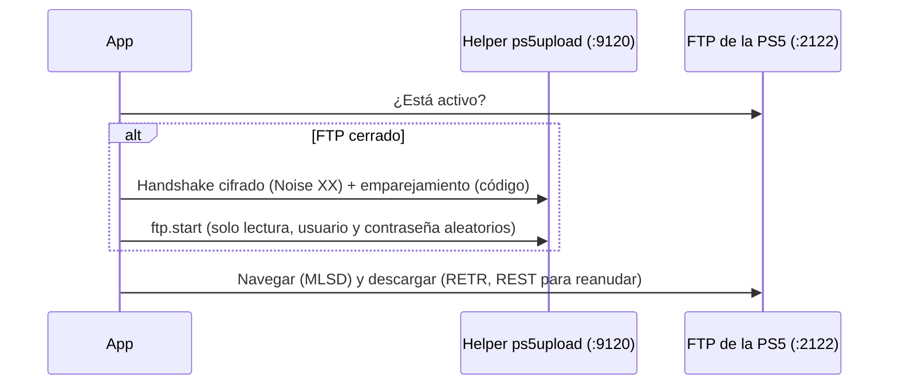

# Pestaña PS5: explorar, descargar, subir y reemplazar juegos

La sección **PS5** permite navegar por los archivos de una PS5 con el payload
de [ps5upload](https://github.com/phantomptr/ps5upload) cargado, descargar
archivos o carpetas completas, subir archivos, eliminar y **comprimir y
reemplazar** un juego directamente en la consola.

## Requisitos

- PS5 con jailbreak y el **payload de ps5upload** cargado (su helper escucha en el
  puerto **9120**). La carpeta [`payload/`](../payload/) incluye la versión probada
  (6.4.0) y explica cómo cargarla. No hace falta la app de escritorio de ps5upload.
  **No uses ps5upload 7.0 o posterior:** esa versión eliminó el servidor FTP
  (`ftp.start`) del que depende esta sección.
- La PS5 y este equipo en la **misma red local** (mejor por cable).

## Primera conexión: emparejamiento

1. Carga el payload de ps5upload en la PS5.
2. En la app, abre la sección **PS5** (barra lateral), escribe la IP de la consola
   (*Ajustes → Red → Ver estado de la conexión*) y pulsa **Conectar**.
3. La PS5 muestra una notificación con un **código de 6 dígitos**. Escríbelo en
   el cuadro que abre la app (tienes menos de un minuto).

El emparejamiento se hace **una sola vez**: la app recuerda la consola y las
siguientes conexiones no piden código. Desde entonces, al abrir la app se
**conecta sola** si la PS5 responde (si está apagada, queda en «Sin conexión» sin
mostrar errores), y si la conexión se corta sin que pulses **Desconectar**, intenta
**reconectar** hasta 3 veces y vuelve a la carpeta en la que estabas.

> [!IMPORTANT]
> La PS5 solo acepta emparejamientos nuevos durante los **5 minutos siguientes a
> cargar el payload** (si no tiene otro dispositivo emparejado). Si ves *"La PS5 no
> acepta emparejamientos nuevos"*, vuelve a cargar el payload y conecta enseguida.

## Cómo funciona

- El FTP del helper no arranca solo. La app lo inicia con el protocolo **AVA1**
  de ps5upload, igual que su app de escritorio.
- Lo inicia en **solo lectura** y con **credenciales aleatorias**: otros equipos
  de la red no pueden usarlo para modificar la consola.
- El FTP queda activo hasta que la PS5 se reinicia o entra en reposo. Si otro
  programa lo inició con otras credenciales, la app lo reinicia con las suyas.

## Explorar

- **Doble clic** (o Intro) abre una carpeta; **Subir** vuelve a la anterior.
- La ruta se muestra por tramos: un clic en un tramo abre esa carpeta y un clic en
  el espacio libre permite escribir otra ruta. **Accesos rápidos ▾** ofrece
  `/data/homebrew` (la carpeta que vigila ShadowMount+), `/mnt/usb0`, `/mnt/ext0`…
- Cada elemento lleva una etiqueta: **Juego** (carpeta con Title ID o dentro de
  `homebrew`), **Comprimido** (`.ffpfsc`) o **Imagen** (`.exfat`/`.ffpkg`).
- Bajo la tarjeta de conexión, una tarjeta por **unidad** muestra el espacio usado
  y libre: el almacenamiento interno, cada USB y el ampliado (M.2 o USB ampliado);
  la barra se vuelve ámbar con poco espacio. Se consulta al helper (`fs.volumes`)
  al conectar, con **Actualizar** y tras borrar, subir o reemplazar. El espacio
  libre del disco interno también se ve en la barra lateral.

## Descargar

1. Selecciona uno o varios archivos o carpetas (Ctrl/Mayús para varios).
2. Pulsa **Descargar** en la barra de acciones. La primera vez se pide la carpeta
   de destino (se cambia con **Cambiar** en el panel de transferencias).

| Característica | Detalle |
|---|---|
| Carpetas completas | Se recorren todas las subcarpetas, incluidas las vacías. |
| Reanudar | Cada archivo se escribe como `nombre.part`; si se corta o cancelas, la próxima descarga continúa desde donde quedó (en archivos de más de 2 GiB, solo si el corte fue antes de ese punto; ver más abajo). |
| Ya descargado | Los archivos completos (mismo tamaño) se omiten. |
| Verificación | Cada archivo se compara con el tamaño que informa la PS5 antes de darlo por bueno. |
| Espacio | Se comprueba el espacio libre antes de empezar. |
| Nombres | Los caracteres que Windows no admite se cambian por `_`; un nombre que intente salir de la carpeta de destino (`../`) se descarta. |

Se puede seguir navegando mientras se descarga: cada descarga usa su propia
conexión.

## Comprimir y reemplazar un juego

Selecciona **una** carpeta de juego o imagen `.exfat`/`.ffpkg` y pulsa
**Comprimir y reemplazar…**. La app:

1. **Descarga** el juego a `<carpeta de descargas>/ffpfsc-temporal/` (reanudable) y
   **comprueba con CRC32** que cada archivo es idéntico al de la PS5 (la consola
   calcula el suyo mientras este equipo calcula el propio).
2. **Analiza** el juego y abre la ventana de compresión: modo (con peso
   estimado), núcleos, verificación completa y si borrar los temporales al final.
   Esa ventana muestra exactamente qué se subirá y qué se borrará.
3. **Comprime** a `.ffpfsc` con MkPFS (comprueba antes el espacio de este equipo).
4. **Comprueba el espacio** de la PS5 (`fs.freespace` del helper).
5. **Sube** el archivo como `Juego.ffpfsc.part` y **verifica** su tamaño y su CRC32.
   Si algo no coincide, borra el `.part` y se detiene sin tocar el original.
6. Recién entonces **borra el original** en la PS5.
7. **Publica** el archivo renombrándolo a `Juego.ffpfsc` (misma carpeta).
8. Vuelve el FTP a **solo lectura** y, si lo elegiste, borra los temporales.

El avance se sigue en una fila del **panel de Transferencias**, junto a las
descargas y subidas: indica el paso (*Paso 2 de 3 · Comprimiendo a .ffpfsc*, de
*Descarga → Compresión → Reemplazo*), una barra con el **porcentaje**, la
velocidad y el **tiempo restante** estimado. El botón **Cancelar** de la fila lo
detiene en cualquier momento; si falla o se cancela, la misma fila ofrece
**Reintentar**.

Si cancelas o falla, al volver a intentarlo con el mismo juego:

- la **descarga continúa** donde quedó (los archivos completos se omiten);
- la **compresión** se repite (MkPFS no puede reanudarse);
- la **subida continúa** solo si la parte que quedó en la PS5 pertenece al mismo
  archivo (se comparan sus últimos bytes); si no, empieza de cero.

| Situación | Qué hace la app |
|---|---|
| Caben ambos en la PS5 | Sube primero, verifica y después borra el original (orden seguro). |
| Solo cabe borrando el original | Pregunta antes de **borrar primero**; tu copia local se conserva hasta verificar la subida. |
| No cabe ni borrando | Se detiene sin tocar nada en la PS5. |
| Falla o cancelas | No se borra el original si la subida no se verificó; los archivos locales se conservan y la subida se reanuda. |

> [!WARNING]
> Cierra el juego en la PS5 antes de reemplazarlo. Si el juego estaba registrado
> desde la carpeta, ShadowMount+ registrará la imagen nueva al detectarla.

## Cortes de conexión y reintentos

- Si la conexión se corta durante una descarga o subida, la app **reintenta sola
  hasta 3 veces** (esperando 3, 10 y 20 s) y continúa donde quedó. La
  fila del panel de transferencias muestra "Reintentando (1 de 3)…".
- Al terminar de escribir en la PS5 (subir, reemplazar), el FTP vuelve a solo
  lectura; si la consola no responde a eso (por ejemplo, tras un corte), la app
  reintenta y, si sigue fallando, reinicia el FTP y se reconecta sola.
- **Límite de ps5upload 6.x:** su FTP solo sabe retomar un archivo en los primeros
  2 GiB (guarda la posición en un entero de 32 bits). Si un archivo más grande se
  corta más allá de ese punto, ese archivo se vuelve a descargar o subir desde el
  principio; los archivos ya completos no se repiten. Al reanudar, la app además
  comprueba que la consola envíe desde la posición pedida y nunca escribe más
  allá del tamaño del archivo.
- Solo se reintentan los fallos transitorios (red, tiempo agotado, verificación);
  los definitivos (sin espacio, ruta protegida) se informan de inmediato.
- Si sigue fallando:
  - en el panel de transferencias, **Reintentar fallidas** vuelve a encolar
    las descargas y subidas fallidas o canceladas (en sus mismas filas);
  - en "comprimir y reemplazar", **Reintentar** retoma sin repetir lo hecho:
    no vuelve a comprimir si ya estaba comprimido ni a borrar el original si ya
    se había borrado.

## Subir y eliminar

- **Subir archivo…** sube archivos de este equipo a la carpeta abierta (como
  `.part`, verificados y luego renombrados; una subida cortada se reanuda).
- **Eliminar** borra en la PS5 los elementos seleccionados, tras confirmar con
  la lista exacta de rutas. Lo ejecuta el helper, que **se niega** a borrar raíces,
  carpetas de primer nivel (`/data`, `/mnt/usb0`) y puntos de montaje.
- Para escribir, la app reinicia el FTP con permiso de escritura **solo mientras
  dura la operación** y luego lo vuelve a dejar en solo lectura.

## Datos que guarda la app

En `~/.config/ffpfsc-converter/` (Linux) o `%APPDATA%\ffpfsc-converter\` (Windows):

| Archivo | Contenido |
|---|---|
| `settings.json` | Última IP y puerto, carpeta de descargas y credenciales del FTP que inició la app. |
| `ava1_identity.key` | Identidad de la app ante la PS5 (privada, permisos `600`). |
| `ava1_peers.json` | Clave de cada consola emparejada. Bórralo para volver a emparejar. |

## Solución de problemas

| Mensaje | Qué hacer |
|---|---|
| *No respondió en el puerto 9120* | El payload de ps5upload no está cargado. Cárgalo y reintenta. |
| *No acepta emparejamientos nuevos* | Vuelve a cargar el payload y conecta en menos de 5 minutos. |
| *No aceptó el código* | Pulsa **Conectar** otra vez; la PS5 muestra un código nuevo en cada intento. |
| *No es la PS5 con la que se emparejó* | Cambiaste de consola o reinstalaste: borra `ava1_peers.json` y vuelve a emparejar. |
| *Se perdió la conexión* | La PS5 entró en reposo o se reinició: carga el payload y conecta de nuevo. |
| *La PS5 no permite borrar esa ruta* | Es una raíz, una carpeta de primer nivel o un punto de montaje: el helper lo protege. |
| *La PS5 no tiene espacio* | Libera espacio en la consola o elige otro disco para el juego. |
| Windows: falla una descarga o compresión con rutas muy largas | Los juegos tienen carpetas profundas. Usa una carpeta de descargas corta (por ejemplo `D:\PS5`) o activa las [rutas largas de Windows](https://learn.microsoft.com/es-es/windows/win32/fileio/maximum-file-path-limitation). |
| Windows: el firewall pregunta por la app | Basta permitirla en redes privadas. La app solo abre conexiones salientes hacia la PS5 (9120 y el FTP en modo pasivo). |
| Transferencias de ~10 MB/s | Es el límite de la red, no de la app (medido: 9 MB/s con 1 conexión y 10 MB/s con 4). Conecta la PS5 **y** este equipo por cable a un router o switch gigabit. |
| *El original ya se borró…* | La subida falló tras borrar (solo en el modo "borrar primero"): sube el `.ffpfsc` de la carpeta temporal con **Subir archivo…**. |
