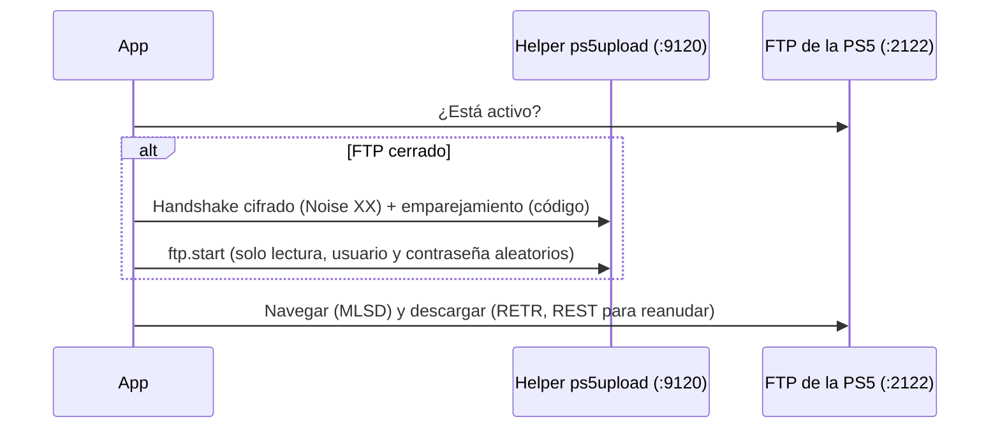

# Pestaña PS5: explorar y descargar archivos de la consola

La pestaña **PS5** permite navegar por los archivos de una PS5 con el payload
de [ps5upload](https://github.com/phantomptr/ps5upload) cargado y descargar
archivos o carpetas completas a este equipo.

## Requisitos

- PS5 con jailbreak y el **payload de ps5upload** cargado (su helper escucha en el
  puerto **9120**). No hace falta la app de escritorio de ps5upload.
- La PS5 y este equipo en la **misma red local** (mejor por cable).

## Primera conexión: emparejamiento

1. Carga el payload de ps5upload en la PS5.
2. En la app, abre la pestaña **PS5**, escribe la IP de la consola
   (*Ajustes → Red → Ver estado de la conexión*) y pulsa **Conectar**.
3. La PS5 muestra una notificación con un **código de 6 dígitos**. Escríbelo en
   el cuadro que abre la app (tienes menos de un minuto).

El emparejamiento se hace **una sola vez**: la app recuerda la consola y las
siguientes conexiones no piden código.

> [!IMPORTANT]
> La PS5 solo acepta emparejamientos nuevos durante los **5 minutos siguientes a
> cargar el payload** (si no tiene otro dispositivo emparejado). Si ves *"La PS5 no
> acepta emparejamientos nuevos"*, vuelve a cargar el payload y conecta enseguida.

## Cómo funciona

- El FTP del helper no arranca solo. La app lo inicia con el protocolo **AVA1**
  de ps5upload, igual que su app de escritorio.
- Lo inicia en **solo lectura** y con **credenciales aleatorias**: otros equipos
  de la red no pueden usarlo para modificar la consola.
- El FTP queda activo hasta que la PS5 se reinicia o entra en reposo. Si otro
  programa lo inició con otras credenciales, la app lo reinicia con las suyas.

## Explorar

- **Doble clic** abre una carpeta; **⬆ Subir** vuelve a la anterior.
- El campo de ruta acepta cualquier ruta y ofrece accesos rápidos:
  `/data/homebrew` (la carpeta que vigila ShadowMount+), `/mnt/usb0`, `/mnt/ext0`…

## Descargar

1. Selecciona uno o varios archivos o carpetas (Ctrl/Mayús para varios).
2. Pulsa **⬇ Descargar selección**. La primera vez se pide la carpeta de destino.

| Característica | Detalle |
|---|---|
| Carpetas completas | Se recorren todas las subcarpetas, incluidas las vacías. |
| Reanudar | Cada archivo se escribe como `nombre.part`; si se corta o cancelas, la próxima descarga continúa desde donde quedó. |
| Ya descargado | Los archivos completos (mismo tamaño) se omiten. |
| Verificación | Cada archivo se compara con el tamaño que informa la PS5 antes de darlo por bueno. |
| Espacio | Se comprueba el espacio libre antes de empezar. |
| Nombres | Los caracteres que Windows no admite se cambian por `_`; un nombre que intente salir de la carpeta de destino (`../`) se descarta. |

Se puede seguir navegando mientras se descarga: cada descarga usa su propia
conexión.

## Datos que guarda la app

En `~/.config/ffpfsc-converter/` (Linux) o `%APPDATA%\ffpfsc-converter\` (Windows):

| Archivo | Contenido |
|---|---|
| `settings.json` | Última IP y puerto, carpeta de descargas y credenciales del FTP que inició la app. |
| `ava1_identity.key` | Identidad de la app ante la PS5 (privada, permisos `600`). |
| `ava1_peers.json` | Clave de cada consola emparejada. Bórralo para volver a emparejar. |

## Solución de problemas

| Mensaje | Qué hacer |
|---|---|
| *No respondió en el puerto 9120* | El payload de ps5upload no está cargado. Cárgalo y reintenta. |
| *No acepta emparejamientos nuevos* | Vuelve a cargar el payload y conecta en menos de 5 minutos. |
| *No aceptó el código* | Pulsa **Conectar** otra vez; la PS5 muestra un código nuevo en cada intento. |
| *No es la PS5 con la que se emparejó* | Cambiaste de consola o reinstalaste: borra `ava1_peers.json` y vuelve a emparejar. |
| *Se perdió la conexión* | La PS5 entró en reposo o se reinició: carga el payload y conecta de nuevo. |
