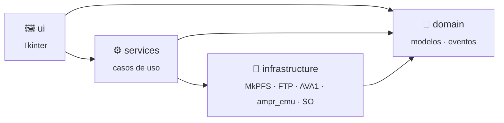

# Información técnica

Punto de entrada para desarrolladores. La guía para usuarios está en el
[README](../README.md).

| Documento | Contenido |
|:----------|:----------|
| [🏗️ Arquitectura](ARCHITECTURE.md) | Capas, árbol de módulos, modelo de hilos, decisiones y cómo extender |
| [🧑‍💻 Desarrollo](DEVELOPMENT.md) | Entorno, tests, multiplataforma, flujo de Git, publicar versiones, rules y skills |
| [🎮 Pestaña PS5](PS5.md) | Protocolo AVA1, FTP de ps5upload, transferencias y reemplazo |
| [🧪 LZ4](LZ4.md) | Formato AMPR, exfat2ampr (PS5) y ampr_emu (PC) |

## Tecnologías

- **Python 3.10+** con **Tkinter** (interfaz) y **tkinterdnd2** (arrastrar y soltar).
- **[MkPFS](https://github.com/PSBrew/MkPFS)** genera los `.ffpfsc`, siempre con el backend
  **zlib-ng** (`isal` produce bloques que la PS5 lee mal: MkPFS #132).
- **cryptography** para el protocolo AVA1 de [ps5upload](https://github.com/phantomptr/ps5upload)
  (X25519, ChaCha20-Poly1305) y `ftplib` para su FTP.
- **lz4** para el empaquetador de [ampr_emu](https://github.com/drakmor/ampr_emu) (LZ4 en el PC).
- **pytest**, **pyftpdlib** (servidor FTP real en los tests) y **ruff**.

## Componentes de terceros

| Componente | Versión | Cómo llega |
|:--|:--|:--|
| ps5upload (payload) | 6.4.0 | Incluido en [`payload/`](../payload/) |
| exfat2ampr (`exfat2ampr.elf`) | 1.45 | Lo descarga el instalador en `third_party/` |
| ampr_emu (herramientas en Python y `libSceAmpr.sprx`) | 0.4.2.1 | Lo descarga el instalador en `third_party/` |

`tools/fetch_third_party.py` (lo llaman `instalar.sh` e `instalar.ps1`) descarga cada archivo
desde su página oficial y comprueba el SHA-256 fijado en `config.THIRD_PARTY_ASSETS`;
`third_party/` no se versiona. Son proyectos GPL-3.0: se ejecutan aparte, nunca se enlazan
con el código de la app.

## Arquitectura en una mirada

Capas donde **las dependencias solo apuntan hacia abajo** y la interfaz nunca habla
directamente con MkPFS, la PS5 ni el sistema operativo:



```text
src/ffpfsc_converter/
├── config.py          # todas las constantes de negocio
├── errors.py          # errores con mensajes listos para el usuario
├── domain/            # modelos y eventos — Python puro
├── infrastructure/    # MkPFS, FTP, AVA1, exfat2ampr, ampr_emu, disco y SO
├── services/          # descubrir, analizar, estimar, convertir, transferir, LZ4
└── ui/                # vistas, presentadores (textos), tema y widgets propios
```

Los servicios corren en hilos de fondo y publican **eventos tipados** en una cola; la ventana
los consume en el hilo de Tkinter. Detalle completo en [ARCHITECTURE.md](ARCHITECTURE.md).

## Desarrollo rápido

```bash
./instalar.sh --dev              # + pytest y ruff (Windows: instalar.ps1 -Dev)
source .venv/bin/activate        # Windows: .venv\Scripts\activate

pytest                           # tests
ruff check src tests tools       # lint
python tools/check_standards.py  # ≤ 250 líneas por archivo y docstrings completas
python -m ffpfsc_converter       # ejecutar desde el código
```

Un cambio está terminado cuando pasan las tres comprobaciones. Las reglas obligatorias
(archivos de 250 líneas como máximo, docstrings en español neutro con `Args`/`Returns`/`Raises`,
código limpio y buenas prácticas) están en [`.claude/rules/`](../.claude/rules/) y las guías
detalladas en las skills de [`.claude/skills/`](../.claude/skills/); ver
[DEVELOPMENT.md](DEVELOPMENT.md).

## Desde la terminal

La app acepta rutas para abrir con esos juegos ya en la cola:

```text
./abrir.sh "$HOME/Juegos/Mi Juego" otro.exfat     # Linux
abrir.bat "D:\Juegos\Mi Juego" otro.exfat         # Windows
```
